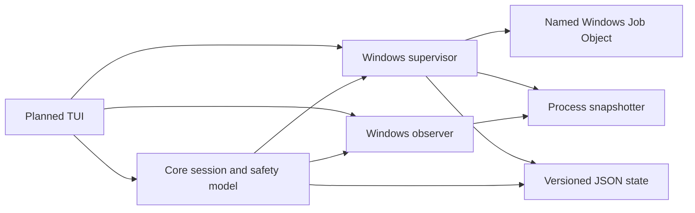
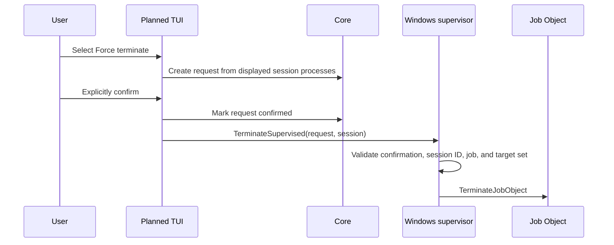
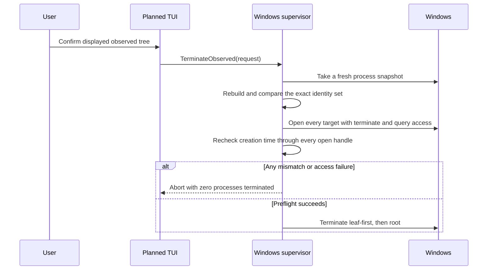

# TaskWatch system design

TaskWatch is a Windows developer tool for finding and safely cleaning up
processes left behind by Claude Code, Codex CLI, and the Codex desktop app.
The MVP treats process termination as a privileged user decision even though
the program itself runs without administrator privileges.

Development is iterative. See [`../PLAN.md`](../PLAN.md) for milestone status
and user checkpoints.

## Safety invariants

These rules apply across every package and planned interface:

1. TaskWatch never terminates a process automatically.
2. A termination request must be explicitly confirmed by the user.
3. A confirmed request is bound to one session and one captured process set.
4. Process identity is PID plus creation time; a PID alone is never trusted.
5. Parent-child edges are accepted only when both processes have creation
   identities and the child was created no earlier than its parent.
6. Observed processes are terminated only after a fresh snapshot, complete
   access preflight, and handle-level identity revalidation.
7. Missing or inaccessible metadata reduces confidence and blocks unsafe
   actions instead of being treated as success.
8. Closing TaskWatch does not implicitly terminate a Job Object.

## Architecture implemented so far

The UI node is not implemented yet. All remaining nodes are implemented and
covered by unit tests.

### Core domain (`internal/core`)

The core package is independent of Windows APIs. It defines:

- tools: Claude CLI, Codex CLI, and Codex desktop;
- confidence: supervised or observed;
- lifecycle: running, exited, leftovers, inaccessible, or stale;
- process identity and resource usage;
- process-tree construction with PID-reuse and creation-order checks;
- immutable termination requests that are unconfirmed by default; and
- observed-target revalidation against a new process snapshot.

This package is the shared safety contract. Platform code supplies facts about
processes, while the core decides whether identities and tree membership are
consistent.

### Windows supervisor (`internal/platform/windows`)

The supervisor owns CLI sessions that TaskWatch launches. For Claude Code or
Codex CLI it:

1. resolves the fixed executable name from `PATH`;
2. creates a uniquely named Windows Job Object;
3. creates the CLI process suspended in a new console and process group;
4. assigns the suspended process to the Job Object;
5. records its creation identity; and
6. resumes it only after assignment succeeds.

This order prevents a CLI from spawning children before TaskWatch establishes
the ownership boundary. The Job Object intentionally does not use
`JOB_OBJECT_LIMIT_KILL_ON_JOB_CLOSE`.

The supervisor can query current job membership, refresh session state, and
reopen a named job after TaskWatch restarts. If launch setup fails before
resume, only the newly created suspended process and its handles are cleaned
up.

### Process snapshotter and observer (`internal/platform/windows`)

The snapshotter uses Windows process APIs to collect PID, parent PID,
executable name and path, command line when accessible, creation time, working
set, and sampled CPU usage. Metadata failures are recorded on the process
rather than failing the entire snapshot. CPU history is pruned when processes
exit.

The observer finds `Codex.exe` roots case-insensitively and groups their current
descendants. It excludes only exact identities already owned by supervised
sessions. Observation is best-effort because the desktop app was not launched
inside TaskWatch's Job Object. Ambiguous or identity-less trees remain visible
as inaccessible and cannot form a safe termination set.

### Persistence (`internal/store`)

Persistence stores only supervised session metadata in schema-versioned JSON:
session ID, tool, named job, workspace, root PID and creation time, and session
start time. Writes use a temporary file, flush, and atomic rename. Loading a
missing file returns an empty state; unsupported schemas fail visibly.

The planned application layer will place this file under
`%LOCALAPPDATA%\TaskWatch`. Observed desktop groups are deliberately not
persisted because their lineage is best-effort and valid only while observed.

## Termination design

Supervised and observed sessions have different trust boundaries.

### Supervised session

The caller cannot supply an unrelated job name. The job comes from the same
session bound to the confirmed request.

### Observed session

Opening every handle before the first termination prevents a partial cleanup
caused by predictable access failures. Handle-level creation-time checks close
the race between snapshotting and action.

## Planned application layers

### Milestone 3: terminal UI

The Bubble Tea application will be a presentation and orchestration layer; it
will not duplicate platform safety logic. It will:

- recover persisted supervised sessions at startup;
- refresh supervised and observed groups on a bounded interval;
- launch Claude or Codex in separate console windows;
- display confidence, lifecycle, process count, CPU, memory, and process trees;
- create confirmation requests from the exact displayed snapshot;
- show every target before enabling force termination; and
- block normal exit while active groups remain, offering return, leave running,
  or review.

### Milestone 4: real-process integration tests

A small Windows helper executable will create a root, child, and grandchild,
then let the root exit. It will validate Job Object membership, leftover state,
cancel safety, confirmed cleanup, and named-job recovery with real processes.

### Milestone 5: executable and handoff

The final MVP slice will add the command entry point, `--help`, `--version`, a
concise README, and a portable Windows x64 build. Formatting, vet, unit and
integration tests, manual agent smoke tests, and a whole-system safety review
must pass before the binary is presented as complete.

## Current limitations

- There is no executable or TUI yet; the project is currently a tested system
  foundation.
- Real Claude Code, Codex CLI, and Codex desktop smoke tests are still pending.
- Desktop observation cannot provide the same guarantee as Job Object
  supervision.
- Protected or elevated processes may be visible but inaccessible to a
  standard-user TaskWatch process.
- Windows x64 is the only current target.
